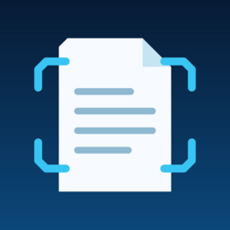
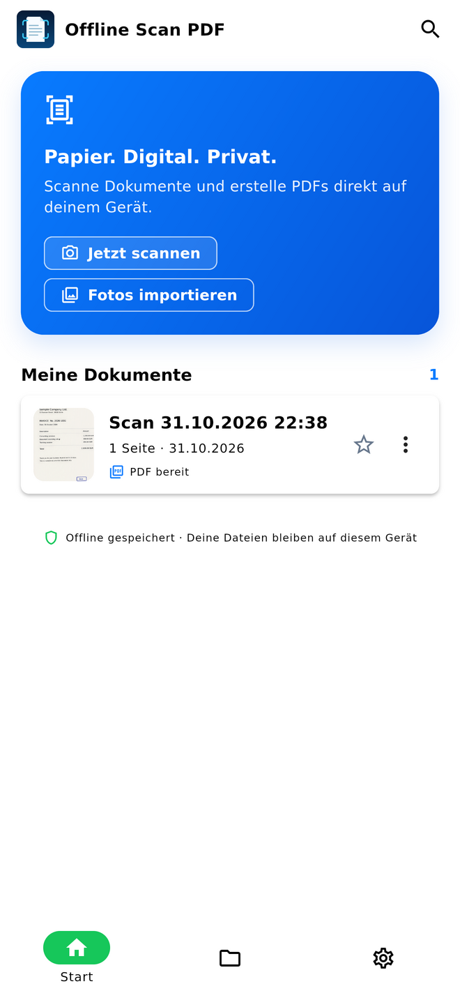
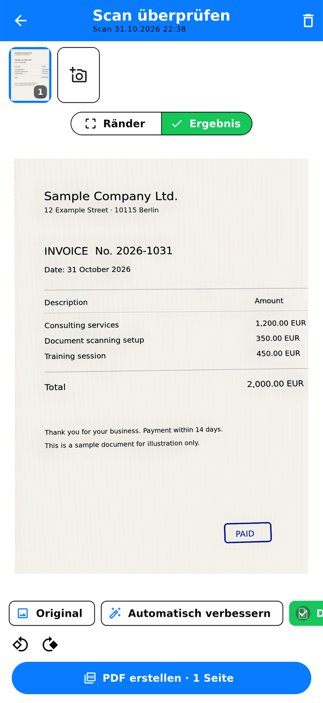
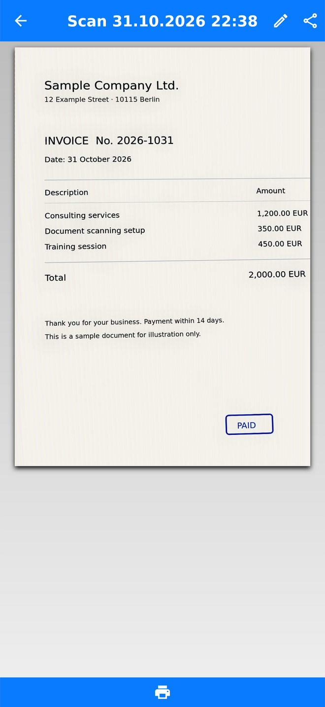
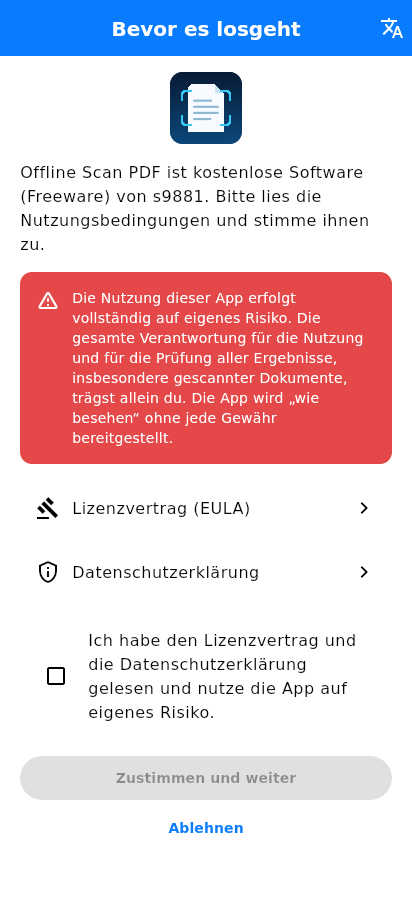
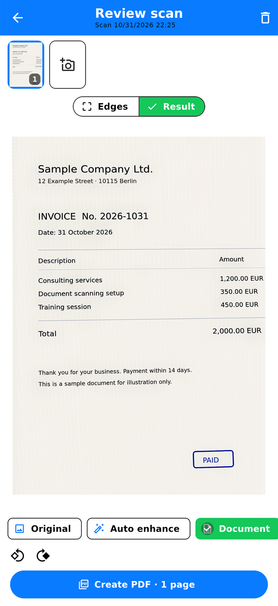
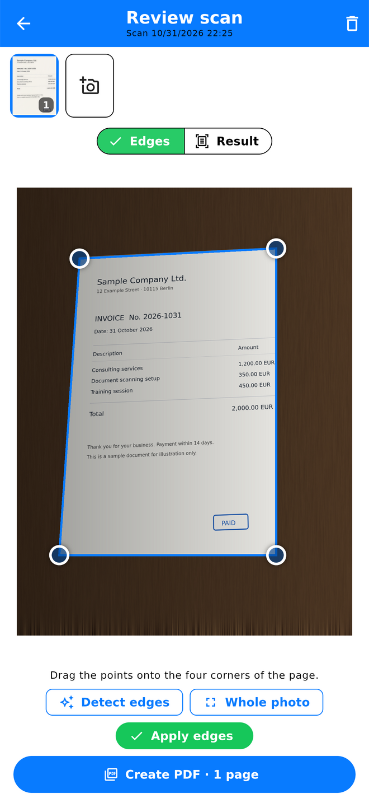

  

<h1 align="center">Offline Scan PDF</h1>

  <b>Offline-Dokumentenscanner für iPhone, iPad und Android.</b> 
  Aus Papier werden scharfe, saubere PDFs – direkt auf dem Handy, ohne Cloud, Konto oder Tracking.

  
  
  
  

<a href="README.md">🇬🇧 English version</a>

  
  
  
  

> **Nutzung auf eigenes Risiko.** Offline Scan PDF ist kostenlose Software und wird „wie besehen“ bereitgestellt. Prüfe gescannte Dokumente immer, bevor du dich auf sie verlässt. Du bestätigst das beim ersten Start. Siehe [LICENSE](LICENSE).

## Download

| Gerät | Wo | Installation |
| --- | --- | --- |
| Android 7 oder neuer | **Google Play** (Link folgt nach der Freigabe) | aus dem Store installieren |
| Android (direkt) | `offline-scan-pdf-<version>.apk` unter **[Releases](../../releases/latest)** | Datei öffnen; einmalig „Unbekannte Apps installieren“ für Browser bzw. Dateimanager erlauben |
| iPhone / iPad, iOS 15 oder neuer | **App Store** (Link folgt nach der Freigabe) | aus dem Store installieren |

Den APK-Download mit der Datei `SHA256SUMS` derselben Version prüfen: `sha256sum -c SHA256SUMS`.

## Funktionen

- 🔒 **Offline & privat** – kein Server, kein Konto, kein Tracking, keine Werbung. Die Android-App fragt nicht einmal nach Internetzugriff.
- 📐 **Automatische Seitenerkennung** – live in der Kamera und bei importierten Fotos; Ecken mit Lupe verschieben für den perfekten Zuschnitt.
- ✨ **Saubere Scans** – Perspektivkorrektur, Schattenentfernung mit weißem Papier und farbigen Stempeln, gestochen scharfes Schwarzweiß, Graustufen und Farbe.
- 🖼️ **Import aus der Galerie** – vorhandene Fotos in PDFs verwandeln.
- 📄 **Scharfe PDFs** – volle Auflösung auf echten A4-Seiten, bereit für Word, Office und Druck; mit jeder App teilen.
- ✏️ **Später bearbeiten** – Ränder, Filter, Drehung und Seiten gespeicherter Dokumente ändern.
- 🌗 **Hell- & Dunkelmodus**, 🌍 **Deutsch & English** – folgt dem Gerät, umschaltbar in den *Einstellungen*.

| Hinweis beim Start | Englische Oberfläche | Ränder anpassen |
| --- | --- | --- |
|  |  |  |

## Datenschutz

Alles passiert auf deinem Gerät: Fotos, Scans und PDFs liegen nur im privaten Speicher der App und sind von Cloud-Backups ausgenommen. Die App erhebt keine Daten und enthält weder Analyse noch Werbung. Dateien verlassen die App nur, wenn du sie selbst teilst. Details: [PRIVACY.md](PRIVACY.md).

## Lizenz

**Freeware** – © 2026 s9881. Alle Rechte vorbehalten. Kostenlose private und gewerbliche Nutzung gemäß [Lizenzvertrag](LICENSE). Verändern, Dekompilieren, Verkaufen und Weitergabe unter anderem Namen sind nicht erlaubt. Der Quellcode wird nicht veröffentlicht.

Die App enthält Open-Source-Komponenten (Flutter, Dart u. a.). Ihre Lizenzen stehen in der App unter *Einstellungen › Open-Source-Lizenzen* und in [THIRD_PARTY_NOTICES.md](THIRD_PARTY_NOTICES.md).

## Hilfe

Ein Problem gefunden? Lege ein [Issue](../../issues) an. Bitte keine persönlichen Dokumente oder Screenshots mit persönlichen Daten posten.
