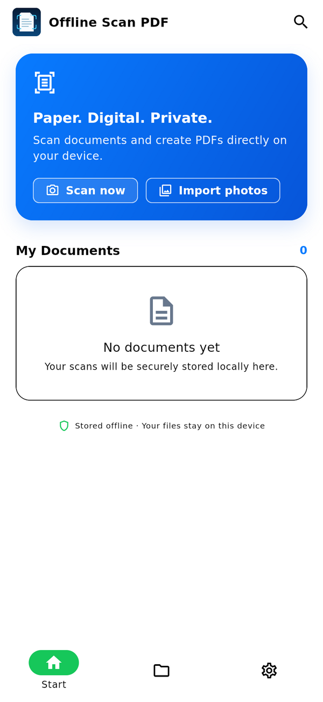
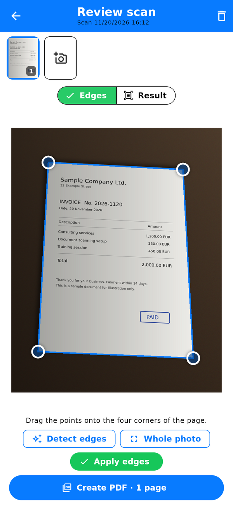
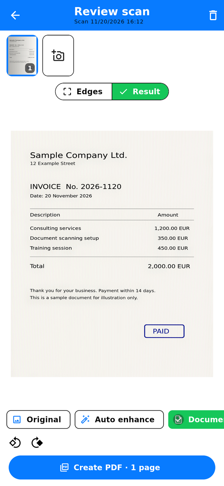
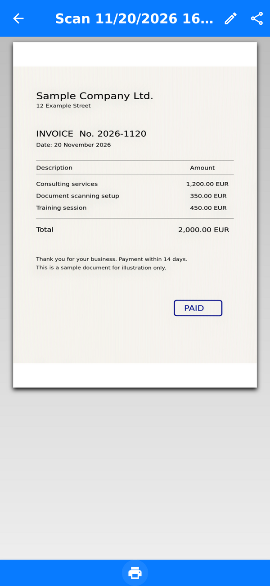

  

<h1 align="center">Offline Scan PDF</h1>

  <b>Paper in. Sharp PDF out. Nothing leaves your phone.</b> 
  The offline document scanner for Android, iPhone and iPad.

  
  
  
  

  
  
  
  

## ⚡ What it does

- 📐 **Finds the page** – automatic edge detection, drag the corners if you like.
- ✨ **Cleans it up** – perspective fix, shadows gone, paper white, stamps stay in color.
- 📄 **Real PDFs** – full resolution on A4, ready to print or share.
- 🖼️ **Photos too** – turn pictures from your gallery into PDFs.
- 🔒 **Truly offline** – no account, no cloud, no ads, no tracking. The Android app does not even ask for internet access.
- 🌗 Light & dark · 🌍 English, Deutsch, Français, Русский

## 📦 Download

| Device | Where |
| --- | --- |
| Android 7+ | `.apk` from the **[latest release](../../releases/latest)** (check with `sha256sum -c SHA256SUMS`) |
| Android, iPhone, iPad | app stores – coming soon |

Every version is published as a release tag (`v1.x.x`).

## 🏠 For private use

Made for scanning your own documents. Always check a scan before you rely on it.

Freeware, use at your own risk: [LICENSE](LICENSE) · [PRIVACY](PRIVACY.md) · [DISCLAIMER](DISCLAIMER.md) · [SECURITY](SECURITY.md) · [Third-party notices](THIRD_PARTY_NOTICES.md)

© 2026 v98881
