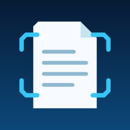
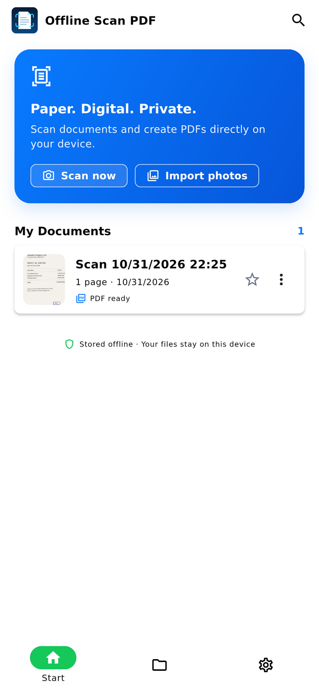
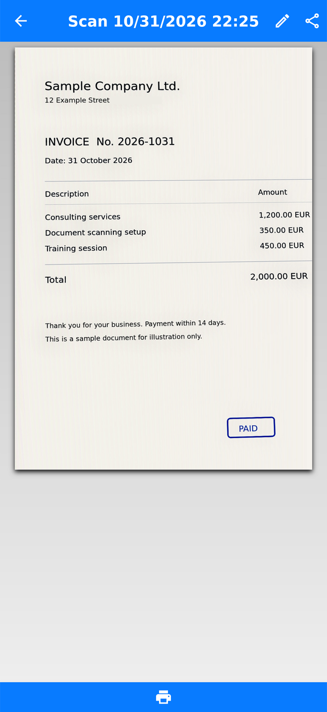

  

<h1 align="center">Offline Scan PDF</h1>

  <b>Offline document scanner for iPhone, iPad and Android.</b> 
  Turn paper into sharp, clean PDFs right on your phone — no cloud, no account, no tracking.

  
  
  
  

  
  
  
  

> **Use entirely at your own risk.** Offline Scan PDF is free software provided "AS IS" without any warranty. To the fullest extent permitted by law, the publisher accepts no liability whatsoever, including for lost data or incorrect scans. Always check scanned documents before relying on them. You accept this when you first start the app. See [LICENSE](LICENSE).

## About

Offline Scan PDF is a document scanner for iPhone, iPad and Android. It turns paper documents into clean PDF files directly on the device: page detection, perspective correction, filters and PDF creation all run locally.

**Who it is for:** Private individuals who want to digitise their own paper documents on their own phone or tablet.

**Status:** Version 1.0.1. Release preparation; store listings are not yet published.

## Motivation

The project was created to scan paper documents into PDF files without uploading them to a cloud service, without a user account and without tracking. Its design goals, as documented in this repository, are offline operation, privacy and sharp, printable PDFs.

## Download

| Device | Where | How to install |
| --- | --- | --- |
| Android 7 or later | **Google Play** (link follows after approval) | install from the store |
| Android (direct) | `offline-scan-pdf-<version>.apk` from **[Releases](../../releases/latest)** | open the file; allow "Install unknown apps" for your browser or file manager once |
| iPhone / iPad, iOS 15 or later | **App Store** (link follows after approval) | install from the store |

Check the APK download with the `SHA256SUMS` file from the same release: `sha256sum -c SHA256SUMS`.

## Features

- 🔒 **Offline & private** — no server, no account, no tracking, no ads. The Android app does not even request internet access.
- 📐 **Automatic page detection** — live in the camera and on imported photos; drag the corners with a magnifier for a perfect crop.
- ✨ **Clean scans** — perspective correction, shadow removal that keeps the paper white and stamps colored, crisp black & white, grayscale and color.
- 🖼️ **Import from the gallery** — turn existing photos into PDFs.
- 📄 **Sharp PDFs** — full resolution on real A4 pages, ready for Word, Office and print; share with any app.
- ✏️ **Edit later** — change edges, filters, rotation and pages of saved documents.
- 🌗 **Light & dark mode**, 🌍 **English, Deutsch, Français, Русский** — follows your device, switchable in *Settings*.

| Startup notice | Edge editor |
| --- | --- |
|  |  |

## Privacy

Everything happens on your device: photos, scans and PDFs are stored only in the app's private storage and are excluded from cloud backups. The app collects no data and contains no analytics or advertising. Files leave the app only when you share them yourself. Details: [PRIVACY.md](PRIVACY.md).

## Intended use

This software is intended exclusively for **personal, private, educational and other non-commercial use**, for example at home, for learning or for personal experimentation. It is not intended for commercial deployment, business operations, commercial services, resale, commercial redistribution or integration into third-party products. These restrictions are part of the [license agreement](LICENSE).

## System requirements

- Android 7.0 (API level 24) or later, or iOS / iPadOS 15 or later
- A device with a camera (importing existing photos also works)
- About 100 MB of free storage for the app and its documents

## Installation

Install the app from Google Play or the App Store once the store listings are available, or download the APK from the latest release of the public repository, open it and allow "Install unknown apps" once. Verify the download with `sha256sum -c SHA256SUMS`.

## Configuration

No configuration file is needed. Language and appearance can be changed in the app under *Settings*. For release builds the signing keystore is supplied through `android/key.properties` or environment variables (see the release documentation); it is never committed.

## Usage example

1. Tap **Scan now** and hold the camera over the page.
2. Check the detected edges and drag the corners if needed.
3. Choose a filter (document, grayscale, colour) and add more pages.
4. Tap **Create PDF** and share or save the file.

## Known limitations

- Page detection depends on light, contrast and background; corners sometimes need manual correction.
- There is no cloud sync and app data is excluded from cloud backups; documents are lost when the app is uninstalled unless you exported them.
- There is no text recognition (OCR); PDFs contain images of the pages.
- On iOS the app can only be installed through the App Store or TestFlight.

## Support

Found a problem? Open an [issue](../../issues). Please do not post personal documents or screenshots containing personal data.

## License

**Freeware for personal, non-commercial use** — © 2026 v98881. All rights reserved.

The software may be used free of charge for personal, private, educational and other non-commercial purposes under the [license agreement](LICENSE). Commercial use, selling, redistributing, modifying or decompiling the software requires prior written permission. Third-party components remain under their own licenses (see [THIRD_PARTY_NOTICES.md](THIRD_PARTY_NOTICES.md) where present); nothing in the license restricts the rights those licenses grant.

## Disclaimer

The software is provided **"AS IS"**, without warranty of any kind, and you use it at your own risk. To the extent that liability can legally be excluded, the author accepts no liability for any damage or loss arising from its use. Mandatory statutory rights remain unaffected. See [DISCLAIMER.md](DISCLAIMER.md).

## Author

**v98881** — see [PUBLICATION_POLICY.md](PUBLICATION_POLICY.md) and [SECURITY.md](SECURITY.md).
