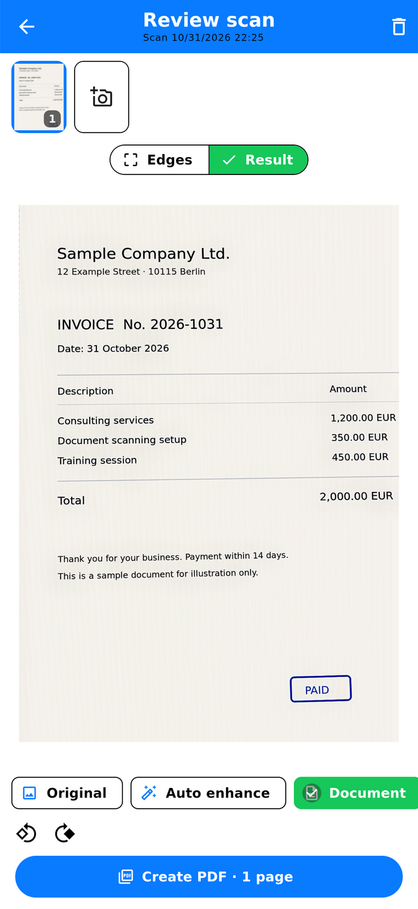
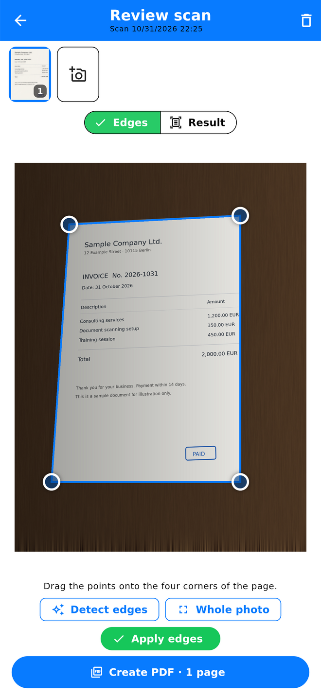
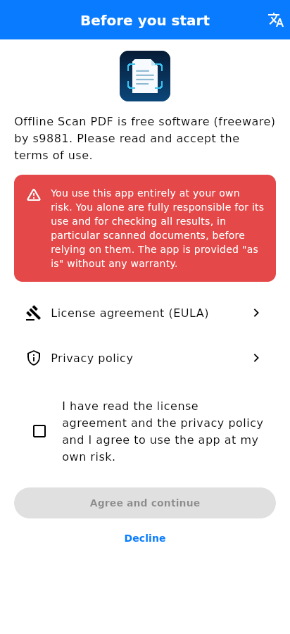

  

<h1 align="center">Offline Scan PDF</h1>

  <b>Offline document scanner for iPhone, iPad and Android.</b> 
  Turn paper into sharp, clean PDFs right on your phone — no cloud, no account, no tracking.

  
  
  
  

<a href="README.de.md">🇩🇪 Deutsche Version</a>

  
  
  
  

> **Use at your own risk.** Offline Scan PDF is free software provided "AS IS". Always check scanned documents before relying on them. You accept this when you first start the app. See [LICENSE](LICENSE).

## Download

| Device | Where | How to install |
| --- | --- | --- |
| Android 7 or later | **Google Play** (link follows after approval) | install from the store |
| Android (direct) | `offline-scan-pdf-<version>.apk` from **[Releases](../../releases/latest)** | open the file; allow "Install unknown apps" for your browser or file manager once |
| iPhone / iPad, iOS 15 or later | **App Store** (link follows after approval) | install from the store |

Check the APK download with the `SHA256SUMS` file from the same release: `sha256sum -c SHA256SUMS`.

## Features

- 🔒 **Offline & private** — no server, no account, no tracking, no ads. The Android app does not even request internet access.
- 📐 **Automatic page detection** — live in the camera and on imported photos; drag the corners with a magnifier for a perfect crop.
- ✨ **Clean scans** — perspective correction, shadow removal that keeps the paper white and stamps colored, crisp black & white, grayscale and color.
- 🖼️ **Import from the gallery** — turn existing photos into PDFs.
- 📄 **Sharp PDFs** — full resolution on real A4 pages, ready for Word, Office and print; share with any app.
- ✏️ **Edit later** — change edges, filters, rotation and pages of saved documents.
- 🌗 **Light & dark mode**, 🌍 **English & Deutsch** — follows your device, switchable in *Settings*.

| Startup notice | German interface | Edge editor |
| --- | --- | --- |
|  |  |  |

## Privacy

Everything happens on your device: photos, scans and PDFs are stored only in the app's private storage and are excluded from cloud backups. The app collects no data and contains no analytics or advertising. Files leave the app only when you share them yourself. Details: [PRIVACY.md](PRIVACY.md).

## License

**Freeware** — © 2026 s9881. All rights reserved. Free to use privately and commercially under the [license agreement](LICENSE). Modification, decompilation, resale and redistribution under another name are not permitted. The source code is not published.

The app contains open-source components (Flutter, Dart and others). Their licenses are shown in the app under *Settings › Open-Source Licenses* and listed in [THIRD_PARTY_NOTICES.md](THIRD_PARTY_NOTICES.md).

## Support

Found a problem? Open an [issue](../../issues). Please do not post personal documents or screenshots containing personal data.
